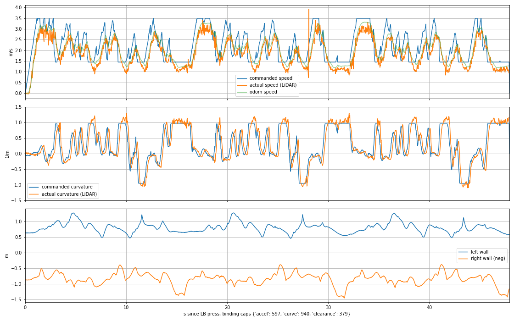
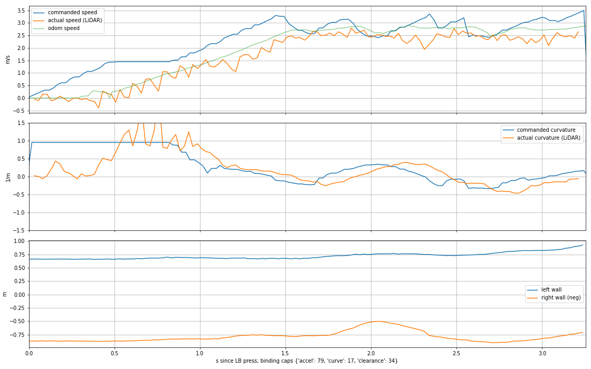
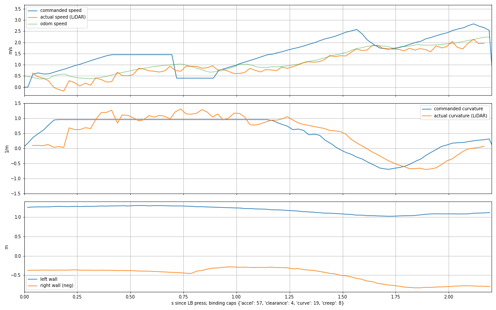

# Run analysis: 20261026-194514

events.jsonl: {'armed': 1, 'status': 5, 'first_message': 6, 'tf_up': 1, 'deadman': 5, 'closing': 1}

## LB hold 1: 47.9 s

- held 47.9 s, 1917 drive commands (40.0 Hz)
- odometry distance 97.2 m, mean 2.03 m/s, peak 3.32 m/s
- zero-speed commands: 2 ticks (0.05 s)

### How the car responded

```
speed lag 0.250 s (RMS speed error 0.43 m/s at that lag)
steering lag 0.150 s, curvature gain 1.043 (left 1.050, right 1.013; RMS 0.074 1/m)
achieved lateral accel p50/p90/p99: 1.08 / 2.21 / 2.90 m/s^2
grip (achieved / commanded curvature, by commanded lateral accel):
  0.3-1.0 m/s^2: n= 229 ratio 0.988
  1.0-1.5 m/s^2: n= 487 ratio 1.062
  1.5-2.0 m/s^2: n= 200 ratio 1.075
  2.0-2.5 m/s^2: n= 138 ratio 1.013
  2.5-3.0 m/s^2: n=  71 ratio 0.933
  3.0-5.0 m/s^2: n=  30 ratio 0.919
odom speed scale (LiDAR / odom, by curvature):
  |k| 0.0-0.1 1/m: n= 491 ratio 0.933
  |k| 0.1-0.3 1/m: n= 427 ratio 0.931
  |k| 0.3-0.6 1/m: n= 244 ratio 0.949
  |k| 0.6-2.0 1/m: n= 727 ratio 0.873
```

### Replay through gap_mirror (shipped YAML)

- replayed 1916 ticks, 1911 paired with a published /drive
- steering error RMS 0.0168 rad, max 0.1063 rad
- speed error median 0.1711 m/s
- zero-speed ticks: replay 0, real 1; only in replay at [], only in real at [0.019]

binding speed caps: {'accel': 597, 'curve': 940, 'clearance': 379}

### Stops

- none

### Counterfactual replay with {'enable_corner_setup': False}

- zero-speed ticks: 0 (without the change: 0)
- open-loop: same scans, so where the changed car would have gone is not modelled

- none



## LB hold 2: 3.3 s

- held 3.3 s, 130 drive commands (40.0 Hz)
- odometry distance 6.2 m, mean 1.92 m/s, peak 2.91 m/s
- zero-speed commands: 0 ticks (0.00 s)

### How the car responded

```
speed lag 0.425 s (RMS speed error 0.39 m/s at that lag)
steering lag 0.150 s, curvature gain 0.962 (left 0.913, right 1.211; RMS 0.079 1/m)
achieved lateral accel p50/p90/p99: 0.74 / 1.88 / 2.65 m/s^2
grip (achieved / commanded curvature, by commanded lateral accel):
  0.3-1.0 m/s^2: n=  17 ratio 1.011
  1.0-1.5 m/s^2: n=  16 ratio 0.926
  1.5-2.0 m/s^2: n=  21 ratio 1.018
odom speed scale (LiDAR / odom, by curvature):
  |k| 0.0-0.1 1/m: n=  17 ratio 0.902
  |k| 0.1-0.3 1/m: n=  46 ratio 0.904
  |k| 0.3-0.6 1/m: n=  23 ratio 0.843
  |k| 0.6-2.0 1/m: n=  13 ratio 1.005
```

### Replay through gap_mirror (shipped YAML)

- replayed 130 ticks, 130 paired with a published /drive
- steering error RMS 0.0407 rad, max 0.2800 rad
- speed error median 0.1590 m/s
- zero-speed ticks: replay 0, real 0; only in replay at [], only in real at []

binding speed caps: {'accel': 79, 'curve': 17, 'clearance': 34}

### Stops

- none

### Counterfactual replay with {'enable_corner_setup': False}

- zero-speed ticks: 0 (without the change: 0)
- open-loop: same scans, so where the changed car would have gone is not modelled

- none



## LB hold 3: 2.2 s

- held 2.2 s, 88 drive commands (40.0 Hz)
- odometry distance 2.5 m, mean 1.15 m/s, peak 2.24 m/s
- zero-speed commands: 1 ticks (0.03 s)

### How the car responded

```
speed lag 0.300 s (RMS speed error 0.40 m/s at that lag)
steering lag 0.125 s, curvature gain 1.039 (left 1.019, right 1.072; RMS 0.065 1/m)
achieved lateral accel p50/p90/p99: 0.58 / 1.52 / 2.05 m/s^2
grip (achieved / commanded curvature, by commanded lateral accel):
  0.3-1.0 m/s^2: n=  13 ratio 1.070
  1.0-1.5 m/s^2: n=   8 ratio 1.078
  1.5-2.0 m/s^2: n=   6 ratio 1.042
odom speed scale (LiDAR / odom, by curvature):
  |k| 0.0-0.1 1/m: n=   6 ratio 0.920
  |k| 0.1-0.3 1/m: n=   5 ratio 0.995
  |k| 0.3-0.6 1/m: n=  12 ratio 0.948
  |k| 0.6-2.0 1/m: n=  38 ratio 0.894
```

### Replay through gap_mirror (shipped YAML)

- replayed 88 ticks, 84 paired with a published /drive
- steering error RMS 0.0257 rad, max 0.1092 rad
- speed error median 0.1674 m/s
- zero-speed ticks: replay 0, real 2; only in replay at [], only in real at [0.016, 2.193]

binding speed caps: {'accel': 57, 'clearance': 4, 'curve': 19, 'creep': 8}

### Stops

- none

### Counterfactual replay with {'enable_corner_setup': False}

- zero-speed ticks: 0 (without the change: 0)
- open-loop: same scans, so where the changed car would have gone is not modelled

- none



